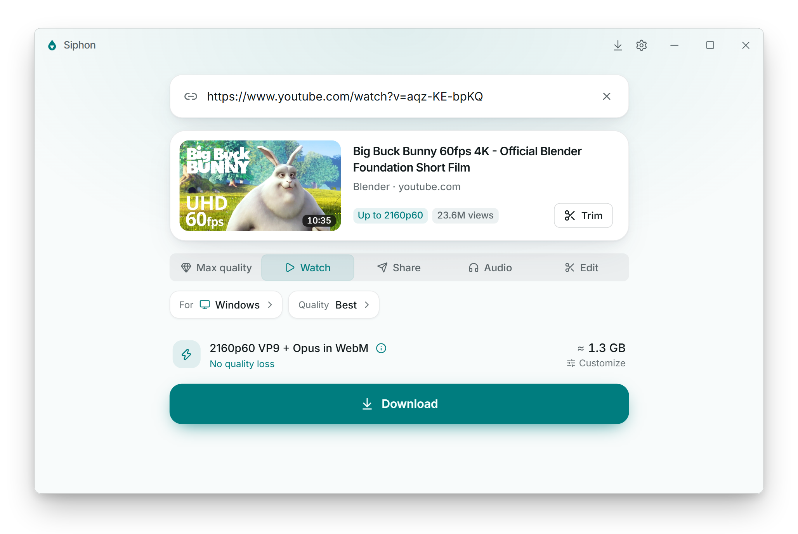
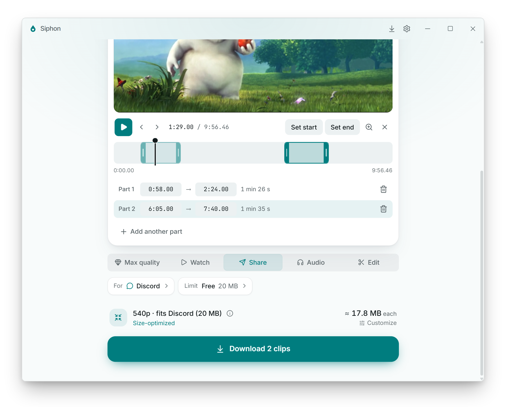
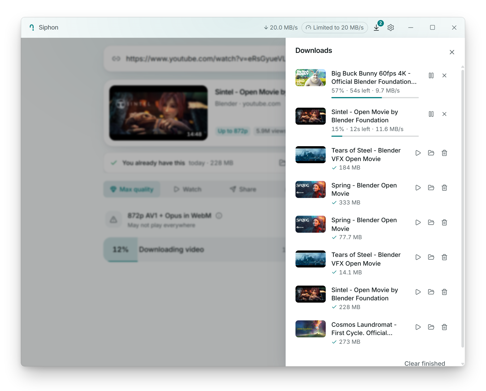
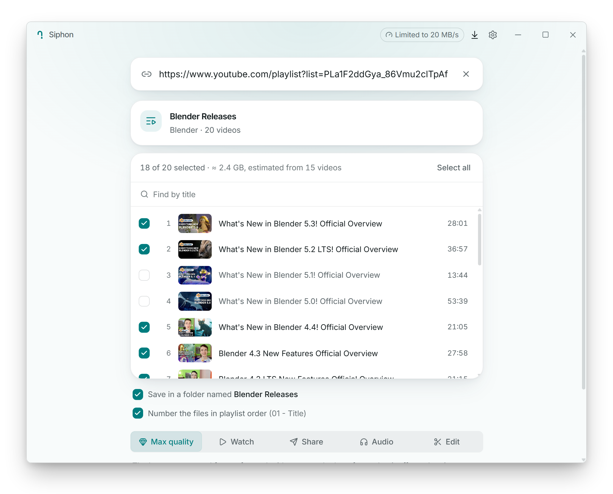
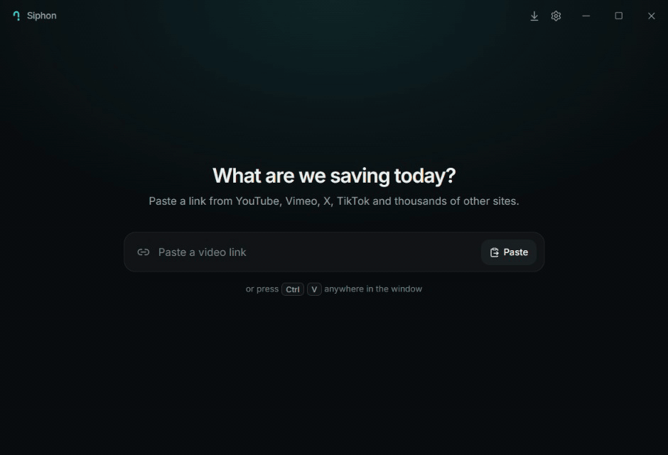

<div align="center">


# Siphon

**Paste a link. Pick where it's going. Download.**

A clean, fast video downloader for Windows, built on [yt-dlp](https://github.com/yt-dlp/yt-dlp) and [FFmpeg](https://ffmpeg.org).

[](https://github.com/Iosif-Christogeorgos/siphon/releases/latest)
[](https://github.com/Iosif-Christogeorgos/siphon/actions/workflows/ci.yml)
[](#install)
[](LICENSE)

[**Download for Windows**](https://github.com/Iosif-Christogeorgos/siphon/releases/latest) · [Features](#features) · [How it works](docs/how-it-works.md)

<br>

<picture>
  <source media="(prefers-color-scheme: dark)" srcset="docs/media/hero-dark.webp">
  
</picture>

</div>

## Why Siphon

yt-dlp can download from well over a thousand sites, but it's a command-line tool, and the hard part is rarely the download: it's knowing which of a video's dozens of formats will actually play on your phone or your TV, or fit under Discord's limit. Siphon makes that choice for you, from the formats the video really has and what your PC can do, and tells you plainly what it's going to make before it makes it.

No account, no ads, no tracking. Siphon talks only to the sites you download from and to GitHub for its own updates.

## Features

### Made for where the video is going

Pick what the video is for and Siphon works out the rest:

| Preset | What you get |
| --- | --- |
| **Max quality** | The best streams exactly as the site has them |
| **Watch** | The best version that plays on Windows, iPhone / iPad / Mac, Android or a TV |
| **Audio** | MP3 or M4A with title, artist and cover art, or the original track untouched |
| **Share** | The best quality that fits Discord, WhatsApp, TikTok, Reels or Shorts |

Original streams are copied whenever the device can play them, because converting is slower and never improves quality. When a conversion is needed, it runs on your graphics card (NVIDIA, Intel or AMD) if it can. Every plan says what it will do before you press Download: **No quality loss**, **Converts**, **Size-optimized** or **May not play everywhere**, with an estimated size.

### Cut exactly the part you want

<picture>
  <source media="(prefers-color-scheme: dark)" srcset="docs/media/share-trim-dark.webp">
  
</picture>

Select one or more parts on a timeline, with a live preview and frame-by-frame keys. Only those parts are downloaded, and every clip starts and ends on the exact frame you chose. Where it can, Siphon re-encodes just the second or two around each cut and copies everything in between untouched, so an hour of 1080p is cut in about 20 seconds. Every cut is checked before it's kept.

Combined with **Share**, each clip is made as sharp as it can be while still fitting the upload limit.

### Subtitles in your language

Pick a language once, and every video with subtitles in it gets them in the form its destination needs: a track you can turn on and off for watching, or drawn into the picture for Discord or WhatsApp. Subtitles written by people come before speech recognition, another language is never swapped in, and if a site won't send them the video is still saved, with a note saying why.

### A queue that keeps going

<picture>
  <source media="(prefers-color-scheme: dark)" srcset="docs/media/queue-dark.webp">
  
</picture>

- **Pause and resume**, even after closing Siphon or restarting the PC. Downloads carry on from where they stopped.
- **Retries on its own** when a connection drops or a site briefly refuses.
- **One speed limit** for all downloads together, so the rest of the house can still stream.
- **Never overwrites** a file you already have, and tells you when you've downloaded a video before.
- **Notifies you** when downloads finish while Siphon is in the background.

### Whole playlists and channels

<picture>
  <source media="(prefers-color-scheme: dark)" srcset="docs/media/playlist-dark.webp">
  
</picture>

Paste a playlist or channel link to pick the videos you want, with an estimated total size. Videos you already have are marked and skipped, so pasting the same playlist again fetches only what's new. Save them in a folder named after the playlist, numbered in order.

### Convert files on your PC

Drop videos or sounds on the window, or press **Browse**, and Siphon makes them into what they're for, just as it does a download: a file that plays on your TV, a clip that fits Discord, an OBS recording as an MP4, the sound alone as an MP3, or a part cut out on the exact frames. A folder or a handful of files open as a list, converted in one go, a few at a time so the PC stays usable. What Siphon makes goes beside each file, under a name of its own; the file itself is never changed, and one that already is what you chose is left as it is.

### Record live streams

Paste a live stream from Twitch, YouTube, Kick and more, and press **Record**, or **Record when it starts** for a scheduled stream or an offline channel. Siphon records from now or, where the site allows, from the start, keeps going through short dropouts, and makes it into a file that plays everywhere when you press Stop or the stream ends. On Twitch it leaves the ads out, with no account or subscription. A crash or power cut never loses what was recorded: Siphon finishes it the next time it starts.

### Twitch chat in the picture

Save a Twitch video, or record a Twitch stream, with its chat drawn into the picture as it looked on Twitch: names in their colours, badges, and every emote, from Twitch, 7TV, BTTV and FFZ, animated ones moving. Drag the box where it doesn't cover anything on the preview, and resize it; Siphon remembers the place for each channel. A recording reads the chat as the stream airs and draws it in as it goes, so when you press Stop the file is ready within moments. Recorded from the start, it gets the chat from before you pressed Record too.

### Sign in only when a video needs it

Age-restricted, members-only or account-only videos can be downloaded with your own account. That unlocks only what your account can already watch. Siphon tries every video without an account first, tells you how likely signing in is to help, and keeps each site's sign-in encrypted for your Windows account. It doesn't bypass DRM: protected videos get a clear message instead.

### Always up to date

Video sites change often, and yt-dlp follows within days. Siphon keeps yt-dlp, FFmpeg and Deno updated in the background, checks every download against its published checksum, and rolls back if a new version misbehaves. Siphon updates itself too, from signed releases, and always asks first.

## Install

1. Download `Siphon_x.y.z_x64-setup.exe` from the [latest release](https://github.com/Iosif-Christogeorgos/siphon/releases/latest) and run it.
2. Windows may show **"Windows protected your PC"**, because the installer isn't signed with a paid code-signing certificate. Choose **More info**, then **Run anyway**.
3. On first launch, Siphon downloads its engines (yt-dlp, FFmpeg and Deno, about 150 MB). After that it keeps them current by itself.

Siphon runs on Windows 11 (64-bit). You don't need to install anything else.

## Using Siphon

<p align="center">
  
</p>

1. **Copy a video link** and press <kbd>Ctrl</kbd> + <kbd>V</kbd> anywhere in Siphon's window.
2. **Pick what it's for**, and optionally a quality. Siphon remembers your choice for next time.
3. **Press Download.** Files go to your Downloads folder unless you choose another in Settings.

Press **Trim** on the video card to download only part of it. In the trim panel, <kbd>Space</kbd> plays, <kbd>,</kbd> and <kbd>.</kbd> step one frame, and <kbd>I</kbd> and <kbd>O</kbd> set the start and end. The **Activity** button in the title bar opens the list of downloads and conversions.

To convert a file on your PC instead, drop it on the window or press **Browse**, then pick what it's for in the same way.

## Documentation

| Document | What's in it |
| --- | --- |
| [How it works](docs/how-it-works.md) | The tools, the planner, trimming, the queue, settings and updates in detail |
| [Presets](docs/presets.md) | What each preset makes, what it assumes, and the sources behind it |
| [Signing in](docs/sign-in.md) | How sign-in works, what is kept where, and what it can't do |
| [Live recording](docs/live.md) | How recording works, what was tested, and its limits |
| [Subtitles](docs/subtitles.md) | Which subtitles a download gets, where each preset puts them, and what was tested |
| [Chat](docs/chat.md) | Twitch chat drawn into the picture: how it is read, timed and drawn, what was measured, and its limits |
| [Files on your PC](docs/local-files.md) | Converting files on your PC: where what is made goes, how the files themselves are kept safe, what was tested |
| [Decisions](docs/decisions.md) | Why things work the way they do, what was measured, and known issues |
| [Development](docs/development.md) | Running from source, checks, building an installer and releasing |

## Build from source

You need Windows 11, [Node.js](https://nodejs.org) 20 or newer, [Rust](https://rustup.rs) and the Microsoft C++ Build Tools. Then:

```sh
npm install
npm run tauri dev
```

The dev build keeps its own settings and downloads, apart from an installed Siphon. Checks, installers and releases are in [docs/development.md](docs/development.md).

Built with [Tauri 2](https://tauri.app), React, TypeScript and Rust.

## Responsible use

Siphon is for personal use. Download only what you have the right to, and respect each site's terms. It doesn't circumvent DRM or any other copy protection.

## License

Copyright (C) 2026 Iosif Christogeorgos

Siphon is free software: you can redistribute it and/or modify it under the terms of the [GNU General Public License](LICENSE) as published by the Free Software Foundation, either version 3 of the License, or (at your option) any later version. It is distributed in the hope that it will be useful, but WITHOUT ANY WARRANTY; see the license for details.

In short: anyone may use, change and share Siphon, but a copy they share, changed or not, must come with its full source under the same license.

yt-dlp, FFmpeg and Deno are not part of Siphon. Siphon downloads them from their own projects when it first starts, and each keeps its own license. The screenshots show Blender Foundation open movies (*Big Buck Bunny*, *Sintel*, *Spring*, *Tears of Steel*, *Cosmos Laundromat*), licensed [CC BY](https://creativecommons.org/licenses/by/3.0/).
