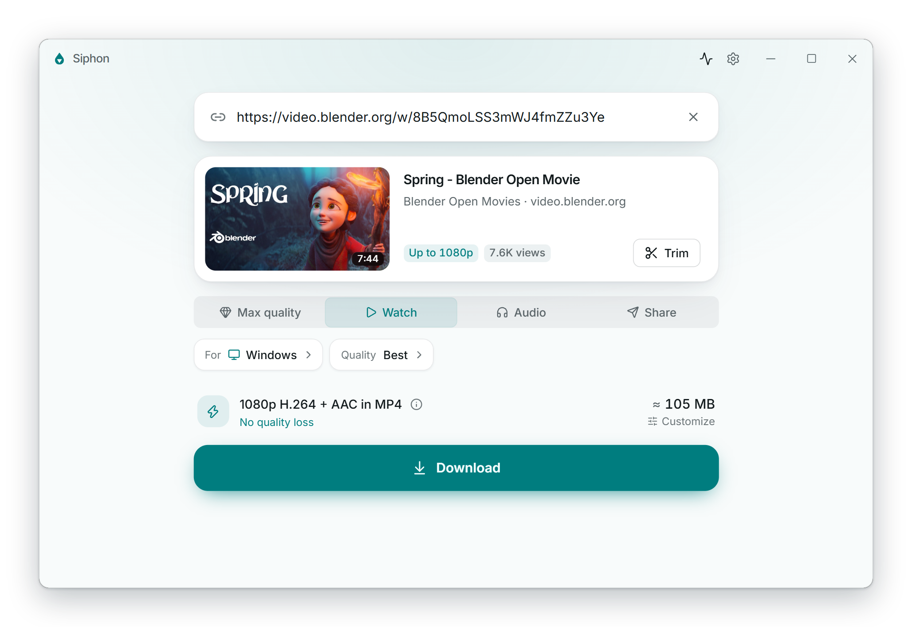
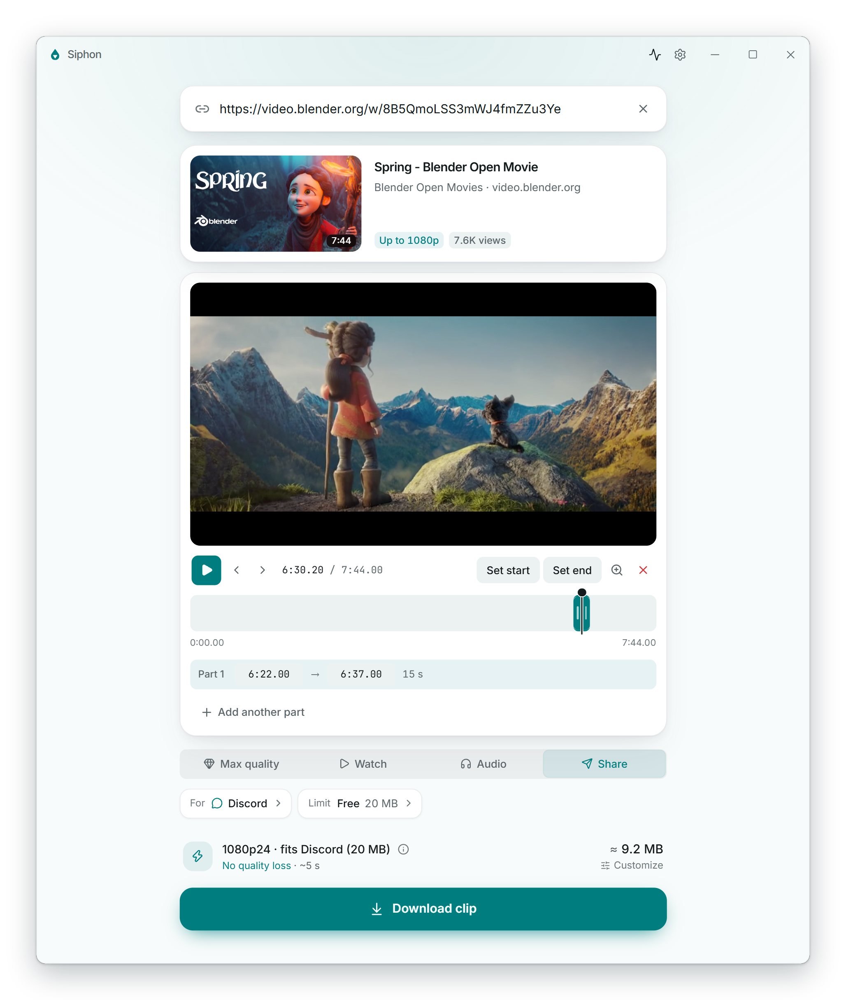
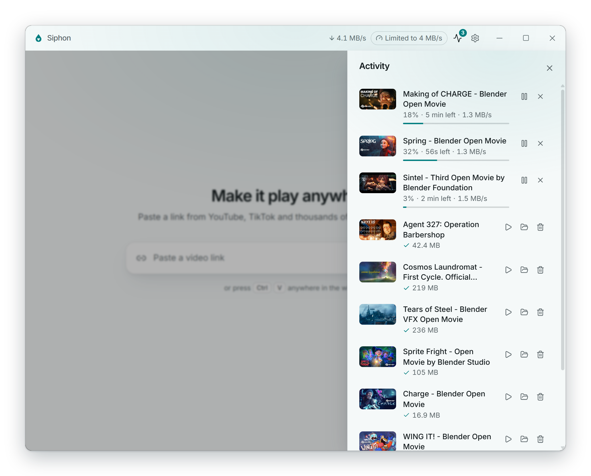

<div align="center">


# Siphon

**Paste a link. Pick where it's going. Download.**

A clean, fast video downloader for Windows, built on [yt-dlp](https://github.com/yt-dlp/yt-dlp) and [FFmpeg](https://ffmpeg.org).

[](https://github.com/Iosif-Christogeorgos/siphon/releases/latest)
[](https://github.com/Iosif-Christogeorgos/siphon/actions/workflows/ci.yml)
[](#install)
[](LICENSE)

[**Download for Windows**](https://github.com/Iosif-Christogeorgos/siphon/releases/latest) · [Features](#features) · [Install](#install) · [Documentation](#documentation)

<br>

<picture>
  <source media="(prefers-color-scheme: dark)" srcset="docs/media/main-dark.webp">
  
</picture>

</div>

## Why Siphon

yt-dlp downloads from more than a thousand sites, but most videos come in dozens of formats, and only some of them play on your phone, your TV or fit under Discord's upload limit. Siphon picks the right one for you, from the formats the video really has, and tells you what it will make before it makes it.

No account, no ads, no tracking.

## Features

### Made for where the video is going

Choose what the video is for, and Siphon works out the rest.

| Preset | What you get |
| --- | --- |
| **Max quality** | The best streams, exactly as the site has them |
| **Watch** | The best version that plays on Windows, iPhone, iPad and Mac, Android or a TV |
| **Audio** | MP3 or M4A with title, artist and cover art, or the original sound untouched |
| **Share** | The sharpest version that fits Discord, WhatsApp, TikTok, Reels or Shorts |

The original is kept whenever it already plays where it's going, because converting is slower and never improves quality. When converting is needed, it runs on your graphics card if it can. Every plan is labelled before you press Download, with an estimated size: **No quality loss**, **Converts**, **Size-optimized** or **May not play everywhere**.

### Cut exactly the part you want

<p align="center">
<picture>
  <source media="(prefers-color-scheme: dark)" srcset="docs/media/trim-dark.webp">
  
</picture>
</p>

Pick one or more parts on a timeline, with a live preview and frame-by-frame keys. Only those parts are downloaded, and each starts and ends on the exact frame you chose. Siphon re-encodes only the second or two around each cut and copies the rest untouched, so an hour of 1080p is cut in about 20 seconds.

### A queue that keeps going

<picture>
  <source media="(prefers-color-scheme: dark)" srcset="docs/media/activity-dark.webp">
  
</picture>

Pause and resume, even after a restart. Dropped connections are retried on their own, one speed limit covers all downloads together, and a file you already have is never overwritten.

### And more

- **Subtitles in your language**, as a track you can switch on, or drawn into the picture for chat apps.
- **Sync to speech** gives every subtitle line the moment its words are spoken, even from another release or language. It's an optional download for NVIDIA graphics cards.
- **Playlists and channels**: pick the videos you want, and skip the ones you already have.
- **Live streams** from Twitch, YouTube, Kick and more, recorded from now or from the start. Twitch recordings leave the ads out.
- **Twitch chat** drawn into the picture, as it looked on Twitch.
- **Files on your PC**: convert them with the same presets, or choose a film's sound and subtitle tracks without converting it.
- **Sign in only when a video needs it**, for age-restricted or members-only videos your account can already watch.
- **Always up to date**: yt-dlp, FFmpeg and Deno update themselves in the background, and Siphon asks before it updates itself.

## Install

1. Download `Siphon_x.y.z_x64-setup.exe` from the [latest release](https://github.com/Iosif-Christogeorgos/siphon/releases/latest) and run it.
2. If Windows shows **"Windows protected your PC"**, choose **More info**, then **Run anyway**. The installer isn't signed with a paid certificate.
3. On first launch, Siphon downloads its tools (about 150 MB). After that it keeps them current by itself.

**Requires** Windows 11, 64-bit. Nothing else needs to be installed. Sync to speech needs an NVIDIA graphics card with 8 GB or more, and about 11 GB of disk space.

## How to use it

1. **Copy a video link** and press <kbd>Ctrl</kbd> + <kbd>V</kbd> anywhere in the window.
2. **Pick what it's for**, and a quality if you want one. Siphon remembers your choice.
3. **Press Download.** Files go to your Downloads folder, or to another folder you choose in Settings.

To convert a file on your PC, drop it on the window or press **Browse**. The **Activity** button in the title bar lists your downloads and conversions.

## Privacy

Siphon talks only to the sites you download from, and to GitHub for updates. If you download Sync to speech, its tools and models are fetched once from GitHub, PyPI, PyTorch and Hugging Face, and then it runs entirely on your PC. A site's sign-in is kept encrypted for your Windows account and sent only to that site.

## Documentation

| | |
| --- | --- |
| [How it works](docs/how-it-works.md) | The tools, presets, trimming, the queue and updates in detail |
| [Presets](docs/presets.md) | What each preset makes, and the sources behind it |
| [Subtitles](docs/subtitles.md) · [Subtitle sync](docs/subtitle-sync.md) | Which subtitles a download gets, and how syncing to speech works |
| [Live recording](docs/live.md) · [Chat](docs/chat.md) | Recording streams, and drawing Twitch chat into the picture |
| [Files on your PC](docs/local-files.md) · [Film tracks](docs/mkv-editor.md) | Converting your own files, and choosing a film's tracks |
| [Signing in](docs/sign-in.md) | How sign-in works, and what is kept where |
| [Decisions](docs/decisions.md) | Why things work the way they do, and known issues |
| [Development](docs/development.md) | Building from source, checks and releases |

## Build from source

You need Windows 11, [Node.js](https://nodejs.org) 20 or newer, [Rust](https://rustup.rs) and the Microsoft C++ Build Tools.

```sh
npm install
npm run tauri dev
```

Built with [Tauri 2](https://tauri.app), Rust, React and TypeScript. See [docs/development.md](docs/development.md) for checks, installers and releases.

## License

Siphon is free software under the [GNU General Public License v3.0 or later](LICENSE). Copyright (C) 2026 Iosif Christogeorgos.

yt-dlp, FFmpeg and Deno are separate projects under their own licenses; Siphon downloads them from their own releases. The films in the screenshots are open movies by the Blender Foundation and Blender Studio, licensed [CC BY](https://creativecommons.org/licenses/by/4.0/).

Siphon is for personal use. Download only what you have the right to, and respect each site's terms. It doesn't bypass DRM or any other copy protection.
